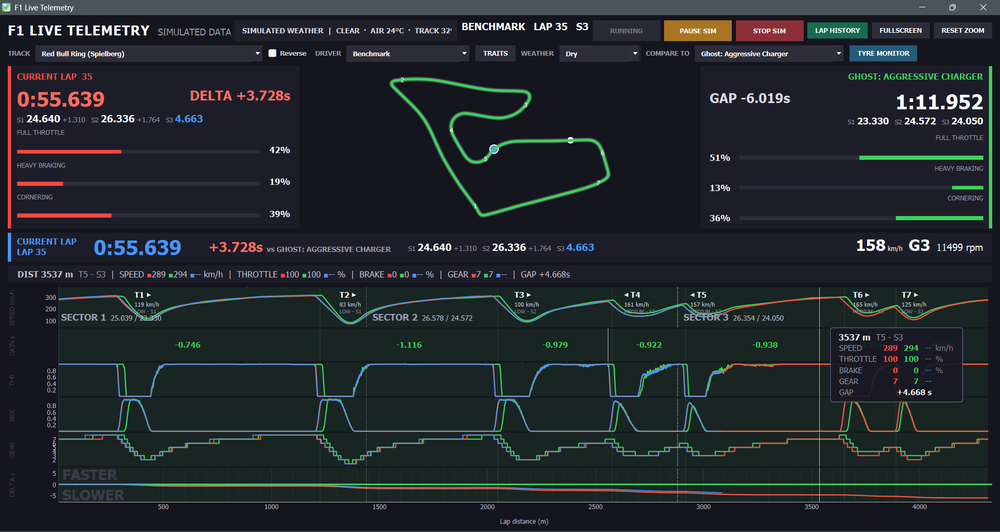

# F1 Telemetry Simulation & Lap Analysis Dashboard

A standalone Python desktop application that generates synthetic Formula-style vehicle telemetry, visualises simulated laps, compares driver performance and exports detailed session data. All telemetry is generated internally by the application; it does not connect to an F1 game or receive external UDP data.

> **Project status:** Personal/educational project. The simulated vehicle, tyre and weather models are simplified approximations for telemetry visualisation and experimentation. They are not a validated Formula 1 vehicle model and should not be used for real-world setup or performance decisions.

## Features

### Live dashboard
- Live speed, throttle, brake, gear and lap-delta traces plotted against distance.
- Circuit map with the simulated/live car position and lap-comparison analysis.
- Current-lap, last-lap and session-best timing information, including sector comparisons.
- Zoom and reset-zoom controls, plus a full-screen view.
- Driver profiles with editable driving traits.

### Simulation
- Fully self-contained synthetic telemetry generation; no game, network connection or external telemetry source is required.
- Embedded circuit centre-lines for 40 circuits from the [`f1-circuits`](https://github.com/bacinger/f1-circuits) dataset, plus a simple test oval.
- Selectable driver profiles, weather presets and tyre compounds.
- Start, pause/resume and stop controls.
- Simplified weather-aware vehicle model and compound/temperature/wear effects.

### Tyre and weather monitoring
- Separate tyre-monitor window showing four tyre temperatures and wear values (FL, FR, RL, RR).
- Soft, Medium, Hard, Intermediate and Wet compound options.
- Weather display for condition, air temperature, track temperature and available rain/wind information.
- In simulation mode, the simplified tyre and weather calculations feed back into the generated vehicle performance.

### Lap analysis and export
- Select completed laps in the lap-history window and inspect their telemetry traces.
- Compare laps against the session-best lap or a generated driver reference/ghost lap.
- Export an Excel workbook containing:
  - **Lap Summary** — lap/sector times, speed and RPM metrics, driving percentages and available weather information.
  - **Telemetry Samples** — recorded telemetry samples and same-distance reference comparisons.
  - **Distance Time Loss** — time delta and change in delta between successive recorded samples.

## Screenshots


```md

```

## Requirements

- Python 3.10 or newer recommended.
- NumPy
- PyQt5
- pyqtgraph
- openpyxl (required for Excel export)

The application also checks for missing packages at startup and attempts to install them using `pip`. Installing from `requirements.txt` first is recommended, particularly in managed or offline environments.

## Installation

### Windows

1. Install Python 3.10+ from [python.org](https://www.python.org/downloads/). During installation, enable **Add Python to PATH**.
2. Clone this repository or download it as a ZIP and extract it.
3. Open Command Prompt or PowerShell in the project folder.
4. Create and activate a virtual environment:

   ```powershell
   py -3 -m venv .venv
   .venv\Scripts\Activate.ps1
   ```

   If PowerShell blocks activation, use Command Prompt instead:

   ```bat
   .venv\Scripts\activate.bat
   ```

5. Install the dependencies:

   ```bash
   python -m pip install --upgrade pip
   python -m pip install -r requirements.txt
   ```

6. Start the dashboard:

   ```bash
   python f1_live_telemetry.py
   ```

### macOS / Linux

Create and activate a virtual environment, install the requirements, then run the script:

```bash
python3 -m venv .venv
source .venv/bin/activate
python -m pip install --upgrade pip
python -m pip install -r requirements.txt
python f1_live_telemetry.py
```

PyQt5 requires a working desktop/display environment. Running the GUI in a headless server or a terminal without a graphical session is not supported by this application as currently written.

## Running the simulation

The default launch starts the built-in simulated-data generator and opens the dashboard:

```bash
python f1_live_telemetry.py
```

Useful options:

```bash
# Choose a circuit (a partial name is accepted)
python f1_live_telemetry.py --track monaco

# Choose a driver profile
python f1_live_telemetry.py --driver "Late Braker"

# Set the initial simulated weather
python f1_live_telemetry.py --weather "Light Rain"

# Change simulation update rate and random seed
python f1_live_telemetry.py --rate 60 --seed 42

# Run the circuit in reverse
python f1_live_telemetry.py --track "Red Bull" --reverse

```

Available weather presets: `Dry`, `Cloudy`, `Light Rain`, `Heavy Rain`, `Storm`.

Available built-in driver profiles include `Benchmark`, `Late Braker`, `Smooth Operator`, `Aggressive Charger`, `Qualifying Hero`, `Cautious Tyre Saver`, `Rookie` and `Custom`. Driver traits can also be edited in the application.

Tyre compounds: `Soft`, `Medium`, `Hard`, `Intermediate`, `Wet`.

## Telemetry source

The dashboard uses **synthetic telemetry generated by the application itself**. Speed, RPM, gear, throttle, brake, steering, position, lap timing, weather and tyre-monitor values are produced by the built-in simulation. No F1 game connection, UDP listener, network port or external telemetry feed is used.

The internal generator produces samples at the configured update rate and passes them directly to the dashboard in memory. The generated values are intended for visualisation and experimentation, not as measurements from a real F1 car.

## Excel export

Open **LAP HISTORY** in the dashboard, select a completed lap to inspect it, then use **EXPORT SESSION TO EXCEL**. Choose the output `.xlsx` path in the save dialog. The workbook contains a summary and sample-level comparison sheets. Sample-level resolution is determined by the simulation update rate; it is not continuous or infinitely high-resolution telemetry.

## How the simulation should be interpreted

The generator creates a plausible, repeatable telemetry stream from a simplified track-following vehicle model. Driver traits influence generated inputs and lap variation. Weather changes the model's grip and environmental parameters. Tyre compound, temperature and accumulated wear influence the model's estimated available grip.

These models are deliberately lightweight and are not calibrated against a real F1 car, tyre test data, or a validated lap-time simulation tool. In particular:

- Tyre wear and temperature are heuristic estimates, not manufacturer tyre data.
- Weather and grip effects are simplified approximations.
- Generated lap times and vehicle behaviour are illustrative, not predictions of real-world performance.
- All displayed telemetry is generated by the simplified simulation; it is not live game telemetry or a validated vehicle dynamics model.

## Project structure

```text
f1-live-telemetry/
├── f1_live_telemetry.py   # Application, synthetic telemetry generator, analysis and GUI
├── requirements.txt       # Python dependencies
├── README.md              # Project documentation
├── CONTRIBUTING.md        # Contribution guidelines
├── SECURITY.md            # Security reporting guidance
├── CITATION.cff           # Citation metadata
├── LICENSE                # MIT licence (review before publishing)
└── .gitignore             # Files excluded from Git
│
└── Screenshots/
    ├── dashboard.png
    ├── lap-history.png
    └── tyre-monitor.png

```

## Data attribution

The embedded circuit centre-line dataset is based on **f1-circuits** by Tomislav Bacinger, distributed under the MIT License:

- Repository: https://github.com/bacinger/f1-circuits
- The circuit data is embedded in this application so it does not need to be downloaded at runtime.

See `LICENSE` for the project licence and `NOTICE` for third-party attribution.

## Disclaimer

This is an independent educational project. It is not affiliated with, endorsed by, or sponsored by Formula 1, the FIA, any F1 team, or the makers/publishers of the F1 games. Formula 1 and related names and marks belong to their respective owners.

## Author

**Rushaad Haradhwala**
